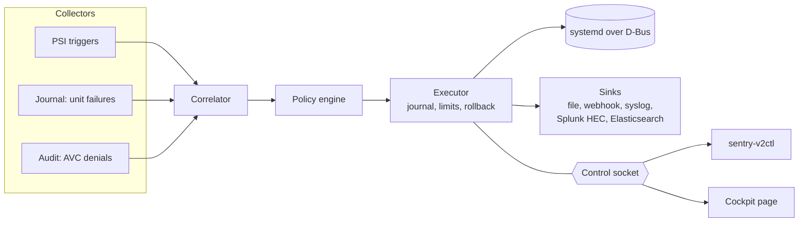

<picture>
  <source media="(prefers-color-scheme: dark)" srcset="assets/header-dark.svg">
  <source media="(prefers-color-scheme: light)" srcset="assets/header-light.svg">
  
</picture>

[](https://github.com/jamesconwaydev/sentry-v2/actions/workflows/ci.yml)
[](https://github.com/jamesconwaydev/sentry-v2/releases)
[](LICENSE)
[](https://www.python.org/downloads/release/python-3120/)
[](docs/installation.md)
[](https://securityscorecards.dev/viewer/?uri=github.com/jamesconwaydev/sentry-v2)

It's 3am and `app-billing.service` has died for the fourth time. The
journal says "permission denied", `ausearch` hands you two hundred denials
from the last hour, and on the same box a batch job has been chewing
through memory since midnight. Was it SELinux? Was it the batch job? You
find out by hand, one terminal at a time, while the pager keeps going.

Sentry-v2 does that legwork for you. It watches cgroup pressure, unit
failures and SELinux denials on your Rocky, Alma, RHEL or CentOS Stream 10
hosts, ties each failure to the denials that landed within a configurable
window of it, and tells you why it thinks they're linked. Then, if you let
it, it does what your runbook would: squeezes the noisy job's memory for
five minutes, or freezes it until the disk calms down, and puts everything
back when the time is up. Out of the box it does none of that. It starts
in dry-run and stays there until you decide it has earned more.

## What it does

- Watches cgroup v2 Pressure Stall Information through kernel triggers,
  systemd unit failures in the journal, and SELinux AVC denials straight
  from the audit netlink stream.
- Correlates a failure with the denials around it and scores each one,
  with reasons: the process was in the unit's cgroup, its domain matches,
  its name matches `ExecStart`.
- Acts, reversibly: runtime `MemoryHigh` and `CPUWeight` throttles,
  freeze and thaw, or a backup of the unit's files followed by a reload.
  Every throttle and freeze has an expiry, and every action is journalled
  before it touches systemd.
- Reports each incident as one redacted JSON bundle, to disk and to an
  HMAC-signed webhook, RFC 5424 syslog, Splunk HEC or Elasticsearch.
- Ships ready for EL10: an RPM with a hardened unit, an SELinux
  subpackage, `sentry-v2ctl`, an optional localhost Prometheus endpoint and
  a Cockpit page. Runtime dependencies come from BaseOS and AppStream only.

## How it fits together



## Quickstart

Grab the RPMs from [Releases](https://github.com/jamesconwaydev/sentry-v2/releases),
then:

```console
# dnf install ./sentry-v2-0.1.0-*.noarch.rpm ./sentry-v2-selinux-0.1.0-*.noarch.rpm

# cat /proc/pressure/memory          # "Operation not supported"? Turn PSI on:
# grubby --update-kernel=ALL --args=psi=1 && reboot

# cd /etc/sentry-v2/policies.d       # three dry-run examples live here
# cp 20-unit-failure-notify.toml 50-myapp.toml
# sed -i 's/^name = .*/name = "myapp-notify"/' 50-myapp.toml

# sentry-v2ctl policy validate
ok: 4 policies
# systemctl enable --now sentry-v2
# sentry-v2ctl status
```

Then break something on purpose and read the bundle; the
[quickstart guide](docs/quickstart.md) walks through it.

## Safety

Sentry-v2 changes running services, so it's built to be boring about it.

- **Dry-run by default.** The daemon and every shipped policy start in
  dry-run. Dry-run runs the whole pipeline, limits included, and records
  exactly what it would have done.
- **Two switches for enforce.** An action is enforced only when
  `daemon.mode` and the policy's `mode` both say `enforce`. `sentry-v2ctl
  pause` and the circuit breaker force dry-run on top of that.
- **Protected units.** SSH, journald, D-Bus, logind, auditd, systemd's own
  services, the top-level slices and Sentry-v2 itself are never throttled,
  frozen or reloaded. Add your own with `protection.protected`.
- **Rollback guarantees.** Each throttle and freeze is written to disk
  with the values it will restore before systemd is touched, then undone at
  expiry, on shutdown, and on the next start after a crash. A throttle you
  changed by hand in the meantime is left alone. A rollback that keeps
  failing raises a critical bundle and blocks new actions on that unit.
- **Limits.** Five active actions, one freeze at a time and 30 minutes per
  action by default. Three systemd failures in ten minutes trip the
  breaker for fifteen.

The details, including the worst-case time a stop can take, are in
[actions and safety](docs/actions-and-safety.md).

## Documentation

| Page | What's in it |
|---|---|
| [Installation](docs/installation.md) | RPMs, turning on PSI, groups, building from source, PyPI |
| [Quickstart](docs/quickstart.md) | Fresh install to first bundle, in dry-run |
| [Configuration](docs/configuration.md) | Every key in `sentry-v2.toml` |
| [Policies](docs/policies.md) | Signals, matching, thresholds, modes, cooldowns |
| [Actions and safety](docs/actions-and-safety.md) | Apply, rollback, crash recovery, limits, breaker |
| [Correlation](docs/correlation.md) | Windows, scoring, PSI episodes, AVC bursts |
| [Bundles](docs/bundles.md) | The schema, an example, redaction |
| [Sinks](docs/sinks.md) | File, webhook, syslog, Splunk HEC, Elasticsearch |
| [sentry-v2ctl](docs/cli.md) | Every subcommand, flag and exit code |
| [Cockpit](docs/cockpit.md) | The Cockpit page and its permissions |
| [Metrics](docs/metrics.md) | Prometheus metrics and alert rules |
| [Hardening and SELinux](docs/hardening.md) | Sandbox, capabilities, SELinux module |
| [Troubleshooting](docs/troubleshooting.md) | PSI off, audit fallback, stuck rollbacks, spool growth |
| [Architecture](docs/architecture.md) | Components, data flow, threads |
| [Development](docs/development.md) | Setup, tests, integration tests, releasing |
| [FAQ](docs/faq.md) | Short answers |

The full index is [docs/README.md](docs/README.md), and changes are in the
[changelog](CHANGELOG.md).

## License

[AGPL-3.0-or-later](LICENSE). Maintained by James Conway
([@jamesconwaydev](https://github.com/jamesconwaydev)).
