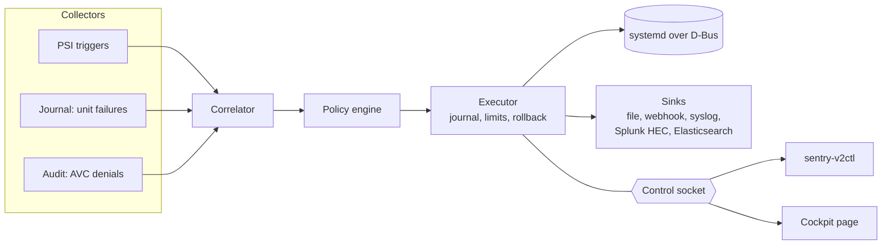

<picture>
  <source media="(prefers-color-scheme: dark)" srcset="https://raw.githubusercontent.com/jamesconwaydev/sentry-v2/main/assets/header-dark.svg">
  <source media="(prefers-color-scheme: light)" srcset="https://raw.githubusercontent.com/jamesconwaydev/sentry-v2/main/assets/header-light.svg">
  
</picture>

[](https://github.com/jamesconwaydev/sentry-v2/actions/workflows/ci.yml)
[](https://github.com/jamesconwaydev/sentry-v2/releases)
[](https://pypi.org/project/sentry-v2/)
[](https://github.com/jamesconwaydev/sentry-v2/blob/main/LICENSE)
[](https://www.python.org/downloads/release/python-3120/)
[](https://github.com/jamesconwaydev/sentry-v2/blob/main/docs/installation.md)
[](https://securityscorecards.dev/viewer/?uri=github.com/jamesconwaydev/sentry-v2)

It's 3am and `app-billing.service` has died for the fourth time. The
journal says "permission denied", `ausearch` hands you two hundred denials
from the last hour, and on the same box a batch job has been chewing
through memory since midnight. Was it SELinux? Was it the batch job? You
find out by hand, one terminal at a time, while alerts keep coming in.

Sentry-v2 does that legwork for you. It watches cgroup pressure, unit
failures and SELinux denials on your Rocky, Alma, RHEL or CentOS Stream 10
hosts, ties each failure to the denials that landed within a configurable
window of it, and tells you why it thinks they're linked. Then, if you let
it, it does what your runbook would: squeezes the noisy job's memory for
five minutes, or freezes it until the disk calms down, and puts everything
back when the time is up. Out of the box it does none of that. It starts
in dry-run and stays there until you decide it has earned more.


That's a real run of [`examples/demo/run.sh`](https://github.com/jamesconwaydev/sentry-v2/tree/main/examples/demo) on a Rocky
Linux 10.2 test VM, with both policies in dry-run. Run it yourself on a
throwaway VM; it cleans up after itself.

## What one incident looks like

Two services were denied the same file within a second of each other.
One died. This is the bundle Sentry-v2 wrote for it, trimmed to the parts
that matter; the [full bundle](https://github.com/jamesconwaydev/sentry-v2/blob/main/examples/demo/incident-unit-failed.json) is
unedited apart from the hostname and machine ID.

```json
{
  "severity": "warning",
  "incident": {
    "kind": "unit_failed",
    "target": "demo-app-99ae0869.service",
    "trigger": { "source": "journal", "kind": "failed", "result": "exit-code" },
    "correlations": [
      {
        "avc": {
          "perms": ["read"],
          "scontext": "system_u:system_r:sentry_demo_app_t:s0",
          "tcontext": "unconfined_u:object_r:sentry_demo_secret_t:s0",
          "tclass": "file",
          "comm": "sentry-demo-app",
          "cgroup_at_receipt": "sentry.slice/sentry-test.slice/demo-app-99ae0869.service"
        },
        "confidence": 0.976,
        "reasons": [
          "pid in unit cgroup",
          "scontext type matches unit domain",
          "comm matches ExecStart"
        ]
      }
    ]
  },
  "context": {
    "psi": {
      "sentry.slice/sentry-test.slice": {
        "memory": { "some": { "avg10": 12.15, "avg60": 4.2, "avg300": 3.1 } }
      }
    }
  },
  "decision": {
    "policy": "demo-app-failed",
    "mode": "dry-run",
    "actions": [{ "action": "notify", "status": "dry_run" }]
  }
}
```

How to read it:

- The linked denial scored 0.976 because three things lined up: the
  denied process was in the failed unit's cgroup, its SELinux domain is the
  unit's, and its name matches the unit's `ExecStart`. The weights and the
  arithmetic are in [Correlation](https://github.com/jamesconwaydev/sentry-v2/blob/main/docs/correlation.md#scoring).
- The denial that isn't there: `sentry_demo_other_t` was denied the
  same file in the same window, and `ausearch` shows it. It ran in another
  unit's cgroup, under another domain and binary, so it scored nothing and
  stayed out. The integration test
  [`test_unrelated_denial_in_window_is_left_out`](https://github.com/jamesconwaydev/sentry-v2/blob/main/tests/integration/test_avc_correlation.py)
  checks exactly this on a real host with SELinux enforcing.
- The pressure in the unit's slice when it failed. Tasks there spent
  about 12% of the last ten seconds stalled on memory, because a memory hog
  was running next door.
- The decision. This policy only notifies, and it's in dry-run. The
  hog's own bundle, [`incident-memory-pressure.json`](https://github.com/jamesconwaydev/sentry-v2/blob/main/examples/demo/incident-memory-pressure.json),
  shows what the other policy would have done: set `MemoryHigh` to 80% of
  the hog's usage and `CPUWeight` to 50 for five minutes, marked `dry_run`.

## What it does

- Watches cgroup v2 Pressure Stall Information through kernel triggers,
  systemd unit failures in the journal, and SELinux AVC denials straight
  from the audit netlink stream.
- Correlates a failure with the denials around it and scores each one,
  with reasons: the process was in the unit's cgroup, its domain matches,
  its name matches `ExecStart`.
- Acts, reversibly: runtime `MemoryHigh` and `CPUWeight` throttles,
  freeze and thaw, or a backup of the unit's files followed by a reload.
  Every throttle and freeze has an expiry, and every action is journalled
  before it touches systemd.
- Reports each incident as one redacted JSON bundle, to disk and to an
  HMAC-signed webhook, RFC 5424 syslog, Splunk HEC or Elasticsearch.
- Ships ready for EL10: an RPM with a hardened unit, an SELinux
  subpackage, `sentry-v2ctl`, an optional localhost Prometheus endpoint and
  a Cockpit page. Runtime dependencies come from BaseOS and AppStream only.

## Compatibility

| | Needs | Tested on |
|---|---|---|
| Distribution | Rocky Linux 10, AlmaLinux 10, RHEL 10 or CentOS Stream 10 | Rocky Linux 10.2 (integration suite), Rocky Linux 10 container (CI) |
| Kernel | The EL10 kernel, with PSI turned on (`psi=1`, see below) | 6.12.0-211.16.1.el10_2 |
| cgroups | cgroup v2, the EL10 default | cgroup2fs |
| systemd | The one EL10 ships, over D-Bus | 257 |
| SELinux | Any mode. Correlation needs denials, so enforcing or permissive | `selinux-policy-targeted` 42.1.18, enforcing |
| Audit | The audit netlink multicast socket; falls back to `/var/log/audit/audit.log` | audit 4.0.3 |
| Python | 3.12, `python3-systemd`, `python3-dbus`, all from BaseOS and AppStream | 3.12.15 |

EL9, Debian, Ubuntu and cgroup v1 aren't supported. AlmaLinux, RHEL and
CentOS Stream 10 use the same packages, but the test runs above are on
Rocky.

## Quickstart

Just want to check policies in CI? `pip install sentry-v2` and run `sentry-v2ctl policy validate`.

Download the RPMs from the
[v0.2.2 release](https://github.com/jamesconwaydev/sentry-v2/releases/tag/v0.2.2)
and check them against `SHA256SUMS` before you install:

```console
$ sha256sum -c SHA256SUMS --ignore-missing
```

Every file also carries build provenance. If you have the `gh` CLI, confirm
a download came from this repository's release workflow:

```console
$ gh attestation verify <file> --repo jamesconwaydev/sentry-v2
```

Prefer to build it yourself? See [Installation](https://github.com/jamesconwaydev/sentry-v2/blob/main/docs/installation.md#from-source).
Then install:

```console
# dnf install ./sentry-v2-0.2.2-*.noarch.rpm ./sentry-v2-selinux-0.2.2-*.noarch.rpm
```

EL kernels ship with PSI off. If `cat /proc/pressure/memory` says
`No such file or directory`, turn it on. The guard below only reboots a
host that doesn't have PSI yet:

```console
# test -e /proc/pressure/memory || { grubby --update-kernel=ALL --args=psi=1 && reboot; }
```

Then add a policy of your own and start the daemon:

```console
# cd /etc/sentry-v2/policies.d       # three dry-run examples live here
# cp 20-unit-failure-notify.toml 50-myapp.toml
# sed -i 's/^name = .*/name = "myapp-notify"/' 50-myapp.toml

# sentry-v2ctl policy validate
ok: 4 policies
# systemctl enable --now sentry-v2
# sentry-v2ctl status
sentry-v2 0.2.2  running for 3s  mode dry-run

COLLECTOR  HEALTH
psi        state=ok, triggers=0, restarts=0, last_error=None
journal    state=ok, restarts=0, last_error=None
audit      source=netlink, user_avc_truncated=0, overruns=0, rcvbuf=425984, restarts=0, last_error=None

no active actions
```

It's healthy when `mode` says `dry-run` (until you change it), every
collector says `state=ok` or, for audit, `source=netlink`, and `restarts`
stays at 0. `state=disabled` on `psi` means PSI is still off;
`source=logfile` on `audit` is a working fallback, explained in
[Troubleshooting](https://github.com/jamesconwaydev/sentry-v2/blob/main/docs/troubleshooting.md#denials-come-from-the-audit-log-not-netlink).

Then break something on purpose and read the bundle; the
[quickstart guide](https://github.com/jamesconwaydev/sentry-v2/blob/main/docs/quickstart.md) walks through it, and the
[demo](https://github.com/jamesconwaydev/sentry-v2/tree/main/examples/demo) stages a fuller incident on a test VM.

## Safety

Sentry-v2 changes running services, so it's built to be boring about it.

| Action | What it changes | When it ends | How it's undone |
|---|---|---|---|
| `throttle` | The unit's `MemoryHigh` and `CPUWeight`, runtime only | At the policy's `duration`, 30 minutes at most by default | The values it read before are written back at expiry, on stop and after a crash. A value you changed by hand meanwhile is left alone. |
| `freeze` | Pauses every process in the unit's cgroup | At `duration`, or early once pressure drops below `release_below` | Thawed at expiry, on stop and after a crash |
| `backup_reload` | Copies the unit's files, then reloads it | At once | Never automatic: `sentry-v2ctl restore <backup id>` |
| `notify` | Nothing; writes a bundle | | |

Every action except `notify` needs both `daemon.mode` and the policy's
`mode` set to `enforce`, a target that isn't protected, and room under the
limits below. Things it never does on its own: restart, stop or kill a
service; change SELinux policy or booleans; touch a protected unit, or a
slice unless you allow it; keep acting on a unit that needed three actions
in half an hour; or change anything at all in dry-run, which is where it
starts.

- Dry-run by default. The daemon and every shipped policy start in
  dry-run, which runs the whole pipeline and records what it would have
  done. Protection and cooldowns are previewed exactly; limits are checked
  against actions really in force, so dry-run never counts its own
  would-be actions.
- Two switches for enforce. An action is enforced only when
  `daemon.mode` and the policy's `mode` both say `enforce`. `sentry-v2ctl
  pause` and the circuit breaker force dry-run on top of that.
- Protected units. SSH, journald, D-Bus, logind, auditd, systemd's own
  services, the top-level slices, everyone's login sessions and Sentry-v2
  itself are never throttled, frozen or reloaded. Add your own with
  `protection.protected`. Slices, which reach every unit under them, are
  off limits too until you set `protection.allow_slices`.
- Rollback guarantees. Each throttle and freeze is written to disk
  with the values it will restore before systemd is touched, then undone at
  expiry, on shutdown, and on the next start after a crash. A throttle you
  changed by hand in the meantime is left alone. A rollback that keeps
  failing raises a critical bundle and blocks new actions on that unit.
- Limits. Five active actions, one freeze at a time and 30 minutes per
  action by default. Three systemd failures in ten minutes trip the
  breaker for fifteen. A unit acted on three times in half an hour is put
  on hold until you `sentry-v2ctl ack` it, because by then it needs a
  person, not a fourth throttle.

The details, including the worst-case time a stop can take, are in
[actions and safety](https://github.com/jamesconwaydev/sentry-v2/blob/main/docs/actions-and-safety.md).

## When it gets it wrong

A linked denial is a lead, not a verdict. Here's where the scoring can
mislead you, and what happens when something underneath fails.

- **A denial from a process that's already gone.** The cgroup is read when
  the denial arrives. If the process has exited by then, only the domain and
  name can count, and a sibling running the same binary in the same domain
  (two instances of a template unit, say) can score 0.76 against the wrong
  one. The reasons show it: no `pid in unit cgroup`. When the cgroup is
  known and belongs to another unit, the denial is left out.
- **Timing.** Only denials from 5 s before to 1 s after the failure count.
  A service that's denied early and dies later needs a wider
  `correlation.before`.
- **Dropped records.** `USER_AVC` records over 1000 bytes are dropped and
  counted in `user_avc_truncated`; denials the kernel drops before the
  daemon reads them show up as `overruns`. Both are in `sentry-v2ctl
  status`.
- **The daemon crashes.** systemd restarts it after 5 s, and the first
  thing it does is roll back every throttle and freeze still on record. A
  unit frozen at the time stays frozen until then; `systemctl thaw` works
  if you can't wait.
- **A rollback fails.** It's retried 10 times. Then the record is marked
  `rollback_failed`, a critical bundle goes to every sink, and no new
  action touches that unit until you retry with `sentry-v2ctl rollback ID`.
- **systemd keeps refusing.** Three failed systemd calls in ten minutes
  trip the circuit breaker, and everything runs in dry-run for fifteen.
- **The host reboots.** Throttles are runtime-only, so they're gone with
  the reboot whatever else happened.

More of this, with the fixes, is in [Troubleshooting](https://github.com/jamesconwaydev/sentry-v2/blob/main/docs/troubleshooting.md)
and [Actions and safety](https://github.com/jamesconwaydev/sentry-v2/blob/main/docs/actions-and-safety.md).

## How it fits together



## Documentation

| Page | What's in it |
|---|---|
| [Installation](https://github.com/jamesconwaydev/sentry-v2/blob/main/docs/installation.md) | RPMs, turning on PSI, groups, building from source |
| [Quickstart](https://github.com/jamesconwaydev/sentry-v2/blob/main/docs/quickstart.md) | Fresh install to first bundle, in dry-run |
| [Configuration](https://github.com/jamesconwaydev/sentry-v2/blob/main/docs/configuration.md) | Every key in `sentry-v2.toml` |
| [Policies](https://github.com/jamesconwaydev/sentry-v2/blob/main/docs/policies.md) | Signals, matching, thresholds, modes, cooldowns |
| [Actions and safety](https://github.com/jamesconwaydev/sentry-v2/blob/main/docs/actions-and-safety.md) | Apply, rollback, crash recovery, limits, breaker |
| [Correlation](https://github.com/jamesconwaydev/sentry-v2/blob/main/docs/correlation.md) | Windows, scoring, PSI episodes, AVC bursts |
| [Bundles](https://github.com/jamesconwaydev/sentry-v2/blob/main/docs/bundles.md) | The schema, an example, redaction |
| [Sinks](https://github.com/jamesconwaydev/sentry-v2/blob/main/docs/sinks.md) | File, webhook, syslog, Splunk HEC, Elasticsearch |
| [sentry-v2ctl](https://github.com/jamesconwaydev/sentry-v2/blob/main/docs/cli.md) | Every subcommand, flag and exit code |
| [Cockpit](https://github.com/jamesconwaydev/sentry-v2/blob/main/docs/cockpit.md) | The Cockpit page and its permissions |
| [Metrics](https://github.com/jamesconwaydev/sentry-v2/blob/main/docs/metrics.md) | Prometheus metrics and alert rules |
| [Hardening and SELinux](https://github.com/jamesconwaydev/sentry-v2/blob/main/docs/hardening.md) | Sandbox, capabilities, SELinux module |
| [Troubleshooting](https://github.com/jamesconwaydev/sentry-v2/blob/main/docs/troubleshooting.md) | PSI off, audit fallback, stuck rollbacks, spool growth |
| [Architecture](https://github.com/jamesconwaydev/sentry-v2/blob/main/docs/architecture.md) | Components, data flow, threads |
| [Development](https://github.com/jamesconwaydev/sentry-v2/blob/main/docs/development.md) | Setup, tests, integration tests, releasing |
| [FAQ](https://github.com/jamesconwaydev/sentry-v2/blob/main/docs/faq.md) | Short answers |

The full index is [docs/README.md](https://github.com/jamesconwaydev/sentry-v2/blob/main/docs/README.md), and changes are in the
[changelog](https://github.com/jamesconwaydev/sentry-v2/blob/main/CHANGELOG.md).

## License

[Apache-2.0](https://github.com/jamesconwaydev/sentry-v2/blob/main/LICENSE). Maintained by James Conway
([@jamesconwaydev](https://github.com/jamesconwaydev)).
