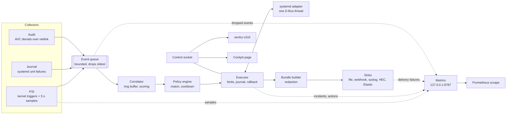

# Architecture

Sentry-v2 is one Python process built on `asyncio`. Events flow one way,
from collectors to sinks, and each stage has one job. Collectors never act,
actions never collect, and only one module talks to D-Bus.

## Components

| Module | Job |
|---|---|
| `collectors/psi.py` | Opens one kernel PSI trigger per watched cgroup and distinct threshold, waits on them with `epoll`, and samples avg10/60/300 every 5 s. Re-resolves cgroup patterns every 30 s. |
| `collectors/journal.py` | Follows the system journal for systemd's own unit-failure messages (PID 1 only) and fetches a unit's recent lines for bundles. |
| `collectors/audit.py` | Joins the audit netlink multicast group, assembles records by serial, and turns AVC, USER_AVC and SELINUX_ERR records into events. Falls back to following `audit.log`. |
| `events.py` | The event dataclasses and the bounded queue between collectors and the correlator. |
| `correlate.py` | Keeps the last `retention` seconds of events and emits `unit_failed`, `psi` and `avc` incidents. Pure: no I/O, driven by timestamps. |
| `policy.py` | The policy model, the protected-unit list, target matching and the engine that turns an incident into an ordered plan. |
| `executor.py` | Decides whether each planned action runs, journals it, applies it, times it out and rolls it back. Owns limits, the breaker and pause. |
| `actions.py` | How each action is captured, applied and undone against systemd. |
| `state.py` | The append-only action journal. |
| `systemd.py` | The only D-Bus client. Reads unit properties, sets runtime limits, freezes, thaws and reloads. |
| `cgroupfs.py` | Reads the cgroup tree and `/proc`. |
| `bundle.py` | Builds and redacts bundles. |
| `sinks/` | One module per destination, plus the manager that gives each one a queue and a worker. |
| `metrics.py` | The Prometheus registry and a minimal HTTP server. |
| `config.py`, `config_types.py` | Strict TOML loading and the frozen config dataclasses. |
| `reporting.py` | Builds bundles in the background (up to 4 at once) with bounded context lookups, and caches unit properties for the correlator. |
| `control.py`, `commands.py` | The control socket: framing, peer credentials, permissions and connection caps; and the commands the CLI and Cockpit use. |
| `daemon.py` | Wires everything together, supervises collectors, handles `SIGHUP` reload and `SIGTERM` shutdown, and talks to systemd's notify socket. |
| `cli.py`, `client.py` | `sentry-v2ctl` and its control-socket client. |
| `cockpit/` | The Cockpit page: plain JavaScript over the control socket. |

## Data flow for one failure

1. systemd logs that `app-billing.service` failed. The journal collector
   turns that into an event and puts it on the queue.
2. A second earlier, the audit collector had queued a denial from PID 4121,
   with that PID's cgroup read from `/proc` the moment it arrived.
3. The correlator holds the failure for `correlation.after`, then scores
   every denial in the window and emits an incident with the matches.
4. The policy engine finds the policies that match, checks each one's
   cooldown for this unit, and returns their actions in order.
5. The executor runs each action: protection check, limits, mode. In
   enforce mode it journals the record as `planned`, calls systemd through
   the adapter, journals `applied` and starts the expiry timer.
6. In the background, the reporter gathers context (pressure for the
   cgroup and its parents, the unit's properties, its last 50 journal
   lines, each lookup capped at 2.5 s), builds and redacts the bundle, and
   hands it to every sink's queue. Control-socket subscribers, such as the
   Cockpit page, hear about the incident at the same moment.

## Startup, reload and shutdown

| Phase | What happens, in order |
|---|---|
| Start | Load and validate the configuration (a bad one stops the daemon with exit code 2); replay the action journal and roll back leftovers; start sinks, metrics and the control socket; start the collectors; send `READY=1`. |
| Running | Each collector runs under a supervisor that restarts it with backoff (1 s doubling to 60 s, reset after 5 minutes of health). The watchdog is pinged from the event loop itself. |
| Reload (`SIGHUP`) | Send `RELOADING=1`; build the new configuration and sinks; swap them in; restart the PSI collector with the new triggers; close the old sinks; send `READY=1`. A failure at any build step keeps the old configuration. |
| Stop (`SIGTERM`) | Send `STOPPING=1`; close the control socket; stop collectors; roll back every active action; give bundles still being built 5 s; give sinks 5 s to deliver. |

## Threads and the event loop

Everything decides on the event loop thread. Blocking work is pushed off it:

| Thread | Runs |
|---|---|
| Event loop (main) | Collectors' fd callbacks, the correlator (ticked every 0.25 s), policy engine, executor, reporter, control socket, metrics server. Metrics are only updated here, so they need no locks. |
| D-Bus worker (one thread) | Every call to systemd. `dbus-python` objects must stay on the thread that made them, and one thread also serialises the calls. Property lookups for bundles and correlation are limited to one in flight, so an action never queues behind more than one of them. |
| Default thread pool | File writes, the spool, HTTP and syslog delivery, and journal lookups for bundles. |

The collectors hand their file descriptors to the loop (`add_reader`):
the PSI `epoll` fd, the journal's fd and the audit netlink socket. Nothing
polls in a busy loop, apart from the audit log fallback, which reads the
file every 0.25 s.

The executor holds one lock around every journal write and D-Bus call, so
an apply, an expiry and an operator's rollback can never interleave on the
same unit. Rollback retries sleep outside the lock.

## Why stdlib only

The package's runtime dependencies are Python 3.12's standard library plus
two distro packages: `python3-systemd` for the journal and `python3-dbus`
for systemd. Both are in BaseOS or AppStream on EL10, so the RPM installs
on a stock host without EPEL or anything from PyPI.

That rules some things out, on purpose:

- TOML parsing is `tomllib`, HTTP is `http.client`, TLS is `ssl`, metrics
  are a hand-written exposition format.
- The two distro bindings are imported lazily inside the modules that use
  them, so the rest of the package imports and tests on any platform,
  including macOS.
- Fewer dependencies means fewer things to audit for a process that runs
  as root and changes other services.
